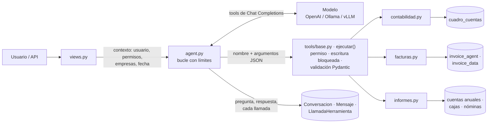

# PMS Copilot (`copilot_pms`)

Asistente para hacer preguntas en lenguaje natural sobre los datos del hotel («¿saldo del banco a 30 de
septiembre?», «dame el PDF de la factura de Makro de agosto», «PyG de 2026»). Un modelo de IA decide qué
consultar, pero **los datos solo salen de herramientas registradas** que llaman al mismo código que las
pantallas de la aplicación. El copilot es **de solo lectura**.

- Pantalla: `/copilot/` · Plantillas de gráficos: `/copilot/graficos/` · API JSON: `/copilot/api/…` ·
  Consola: `python manage.py copilot …`

## Arquitectura



| Decisión | Por qué |
|---|---|
| El modelo nunca toca la base de datos ni escribe SQL | Solo pide herramientas; el ejecutor valida argumentos (Pydantic, `extra="forbid"`) y permisos antes de ejecutar. |
| Las herramientas reutilizan `consultas.py`, `cuentas_anuales.py`, `cajas/resumen.py`… | La cifra del copilot es la misma que la de la pantalla. |
| Resultado con `estado` (`ok`, `vacio`, `aclarar`, `no_disponible`, `invalido`, `denegado`, `error`) | El modelo sabe si puede usar el dato o debe preguntar / explicar; nunca rellena huecos. |
| Cada resultado lleva `fuente`, `fecha_datos` y `avisos` | Borradores no sumados, ejercicio abierto, datos parciales… se dicen siempre. |
| Saldos solo dentro de un ejercicio | Mismo convenio que los extractos: apertura del asiento de apertura, sin asiento de cierre. Un periodo que cruza ejercicios pide aclaración. |
| Solo asientos contabilizados por defecto | Es el saldo oficial; los borradores se avisan y se pueden incluir a petición. |
| Enlaces a PDF de Facturas con IA: URL firmada de `invoice_agent` | Caduca en `SIGNED_URL_SECONDS` y el acceso queda en `EventoRevision`. Las facturas de otra empresa no se revelan. |
| Herramientas de escritura bloqueadas (`ALLOW_WRITE_TOOLS=False`) | Ninguna existe todavía; si se registra una, el ejecutor la rechaza hasta que haya aprobación explícita. |
| Auditoría completa | `LlamadaHerramienta` guarda argumentos, estado, resultado y duración de cada consulta. |
| Los resultados no se reenvían en turnos siguientes | Si hace falta un dato otra vez, se consulta de nuevo (dato fresco). |

## Herramientas

| Herramienta | Qué devuelve | Permiso (con login) |
|---|---|---|
| `buscar_cuentas` | Cuentas por código, nombre o NIF | `cuadro_cuentas.view_cuentacontable` |
| `saldo_cuenta` | Saldo de apertura, movimiento del periodo y saldo final con naturaleza | `view_apunte` + `view_cuentacontable` |
| `balance_sumas_saldos` | Sumas y saldos por subcuenta de un ejercicio | ídem |
| `extracto_cuenta` | Libro mayor con saldo acumulado | ídem |
| `buscar_facturas` | Facturas de Facturas con IA (`ia:<uuid>`) y Gestión de facturas (`ocr:<id>`) | `invoice_agent.view_borrador` o `invoice_data.view_invoicedocument` |
| `documento_factura` | Enlace seguro al original + metadatos para comprobarlo | ídem |
| `cuentas_anuales` | Balance o PyG del PGC 2007 con el ejercicio anterior | `cuadro_cuentas.view_apunte` |
| `resumen_cajas` | Ventas por punto de venta y otros cobros, por mes o año | `cajas.view_cajames` |
| `coste_personal` | Coste de nóminas por departamento (sin datos por empleado) | `nominas.view_nominamensual` |
| `resumen_beneficio` | Análisis de beneficios de gestión: ingresos por origen, gastos, beneficio, margen, departamentos, categorías y canales | `analisis.view_reserva` |
| `grafico` | Gráfico de una plantilla con datos reales (ver abajo) | el de cada plantilla |

**Aún no conectado** (el copilot lo dice en vez de inventar; lista en `tools/__init__.py`): disponibilidad
de habitaciones y reservas, horarios del personal, extractos bancarios, cualquier escritura.

### Gráficos

El modelo nunca escribe código de gráficos: elige una **plantilla** y unos **parámetros validados** y
el servidor calcula los datos con las mismas funciones que las pantallas (`graficos.py`). El chat lo
dibuja con Chart.js, con los colores del análisis de beneficios.

| Plantilla | Datos | Eje |
|---|---|---|
| `beneficio_mensual` | Ingresos, gastos, beneficio y acumulado (análisis) | meses |
| `gastos_mensuales` | Proveedores, acreedores y personal (análisis) | meses |
| `ingresos_mensuales` | Estancias, extras, tasas, bar, comedor, menús, parking (análisis) | meses |
| `gastos_por_departamento` | Gasto por departamento (análisis) | categorías |
| `gastos_por_categoria` | Gasto por categoría: comida, bebida, luz... (análisis) | categorías |
| `ventas_cajas_mensuales` | Bar, comedor, chill out y otros cobros (cajas) | meses |
| `coste_personal_mensual` | Coste de nóminas por departamento (nóminas) | meses |
| `saldo_cuenta_mensual` | Saldo a fin de mes de una cuenta (contabilidad) | meses |
| `resultado_contable_mensual` | Grupos 7 y 6 y resultado (contabilidad) | meses |

Parámetros: `anio`, `series`, `tipo` (barras, barras_apiladas, barras_horizontales, lineas, area,
tarta), `comparar_con` (hasta 2 años), `desde_mes`/`hasta_mes`, `mes`, `cuenta`, `con_iva`, `titulo`.

- **Editar con palabras**: «ponlo en líneas», «solo bar y comedor», «compáralo con 2025». El historial
  que recibe el modelo incluye los parámetros del último gráfico (`[Gráfico mostrado: grafico {…}]`) y
  vuelve a llamar a `grafico` con el cambio. Lo que no encaja en los parámetros se rechaza con
  `aclarar` (p. ej. una tarta por meses o series que no existen, con la lista de las disponibles).
- **Plantillas sin IA**: `/copilot/graficos/` permite elegir plantilla y parámetros en un formulario;
  usa la misma herramienta (validación y permisos).
- Añadir una plantilla: una función `(anio, opciones) -> (etiquetas, {serie: [Decimal]})` y una
  entrada en `PLANTILLAS`.

### Añadir una herramienta

```python
# copilot_pms/tools/reservas.py
class DisponibilidadArgs(BaseModel):
    model_config = ConfigDict(extra="forbid")
    llegada: date
    salida: date
    tipo_habitacion: str | None = None

@herramienta("disponibilidad_habitaciones", descripcion="…", argumentos=DisponibilidadArgs,
             dominio="reservas", permisos=("reservas.view_…",))
def disponibilidad(p, ctx):
    ...
    return Resultado(datos={...}, fuente="PMS: inventario", fecha_datos=consultado_en())
```

Importarla en `tools/__init__.py` y quitarla de `PENDIENTES`. Ni el agente ni las vistas cambian.

## Modelo y configuración

Modelo principal: **Qwen3.5-9B** (Apache 2.0), servido con vLLM en el servidor local. Cómo
arrancarlo, cuantización FP8 para 16 GB, razonamiento y alternativa con Ollama:
[`deploy/README.md`](deploy/README.md).

En `.env` (ver `.env.example`):

```
COPILOT_BASE_URL=http://IP-DEL-SERVIDOR:8000/v1
COPILOT_API_KEY=<clave de vLLM>
COPILOT_MODEL=Qwen/Qwen3.5-9B
COPILOT_ENABLE_THINKING=False      # Qwen3.5 razona por defecto; aquí se desactiva
COPILOT_REQUIRE_LOGIN=False
```

El muestreo (`COPILOT_TEMPERATURE`, `TOP_P`, `TOP_K`, `PRESENCE_PENALTY`) viene con los valores que
recomienda Qwen. Para usar OpenAI en la nube mientras no hay servidor basta con vaciar `BASE_URL`,
poner la clave y el modelo (ejemplo en `.env.example`). El resto de opciones (pasos máximos, llamadas
por pregunta, historial…) están en `conf.py`.

## Consola

```powershell
python manage.py copilot herramientas
python manage.py copilot ejecutar saldo_cuenta "{\"cuenta\": \"572\", \"hasta\": \"2026-09-30\"}"
python manage.py copilot preguntar "¿Saldo del banco a 30 de septiembre?"
```

`ejecutar` no usa IA: enseña exactamente el JSON que recibiría el modelo.

## API

```bash
POST /copilot/api/preguntar     {"pregunta": "Saldo de la 572", "conversacion": "<uuid opcional>"}
→ {"conversacion": "…", "estado": "ok", "respuesta": "…", "modelo": "…",
   "consultas": [{"herramienta": "saldo_cuenta", "argumentos": {…}, "estado": "ok",
                  "fuente": "…", "fecha_datos": "…", "enlaces": [{"nombre": "extracto", "url": "/contabilidad/…"}]}]}

GET  /copilot/api/herramientas  → herramientas disponibles para quien pregunta y capacidades pendientes
```

Errores: `{"error": {"code", "message"}}`. Las escrituras requieren la cabecera `X-CSRFToken`.

## Entrenamiento y evaluación

- `python manage.py copilot_hotel_ficticio`: llena una base de datos **aparte** (`DB_NAME=cuentas_ficticio`)
  con un hotel inventado (contabilidad, facturas con PDF, cajas, nóminas, análisis).
- `python manage.py copilot_dataset`: genera conversaciones de entrenamiento ejecutando las herramientas
  de verdad sobre ese hotel (`entrenamiento/escenarios.py`: 20 escenarios, incluidos los casos de
  aclarar, no conectado, solo lectura e instrucciones escondidas en los datos).
- `python manage.py copilot_evaluar`: mide el modelo configurado sobre el test (herramienta, argumentos,
  no llamar cuando no toca, cifras inventadas).
- El afinado en GPU y la mezcla con datasets públicos (When2Call, ToolACE, Toucan) están en
  [`training/copilot/`](../training/copilot/README.md).

## Tests

`python manage.py test copilot_pms` (proveedor falso, sin red y con datos ficticios).
