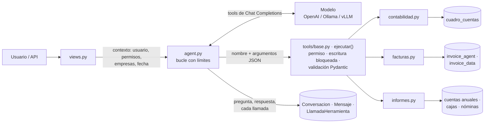

# PMS Copilot (`copilot_pms`)

Asistente para hacer preguntas en lenguaje natural sobre los datos del hotel («¿saldo del banco a 30 de
septiembre?», «dame el PDF de la factura de Makro de agosto», «PyG de 2026»). Un modelo de IA decide qué
consultar, pero **los datos solo salen de herramientas registradas** que llaman al mismo código que las
pantallas de la aplicación. El copilot es **de solo lectura**.

- Pantalla: `/copilot/` · API JSON: `/copilot/api/…` · Consola: `python manage.py copilot …`

## Arquitectura



| Decisión | Por qué |
|---|---|
| El modelo nunca toca la base de datos ni escribe SQL | Solo pide herramientas; el ejecutor valida argumentos (Pydantic, `extra="forbid"`) y permisos antes de ejecutar. |
| Las herramientas reutilizan `consultas.py`, `cuentas_anuales.py`, `cajas/resumen.py`… | La cifra del copilot es la misma que la de la pantalla. |
| Resultado con `estado` (`ok`, `vacio`, `aclarar`, `no_disponible`, `invalido`, `denegado`, `error`) | El modelo sabe si puede usar el dato o debe preguntar / explicar; nunca rellena huecos. |
| Cada resultado lleva `fuente`, `fecha_datos` y `avisos` | Borradores no sumados, ejercicio abierto, datos parciales… se dicen siempre. |
| Saldos solo dentro de un ejercicio | Mismo convenio que los extractos: apertura del asiento de apertura, sin asiento de cierre. Un periodo que cruza ejercicios pide aclaración. |
| Solo asientos contabilizados por defecto | Es el saldo oficial; los borradores se avisan y se pueden incluir a petición. |
| Enlaces a PDF de Facturas con IA: URL firmada de `invoice_agent` | Caduca en `SIGNED_URL_SECONDS` y el acceso queda en `EventoRevision`. Las facturas de otra empresa no se revelan. |
| Herramientas de escritura bloqueadas (`ALLOW_WRITE_TOOLS=False`) | Ninguna existe todavía; si se registra una, el ejecutor la rechaza hasta que haya aprobación explícita. |
| Auditoría completa | `LlamadaHerramienta` guarda argumentos, estado, resultado y duración de cada consulta. |
| Los resultados no se reenvían en turnos siguientes | Si hace falta un dato otra vez, se consulta de nuevo (dato fresco). |

## Herramientas

| Herramienta | Qué devuelve | Permiso (con login) |
|---|---|---|
| `buscar_cuentas` | Cuentas por código, nombre o NIF | `cuadro_cuentas.view_cuentacontable` |
| `saldo_cuenta` | Saldo de apertura, movimiento del periodo y saldo final con naturaleza | `view_apunte` + `view_cuentacontable` |
| `balance_sumas_saldos` | Sumas y saldos por subcuenta de un ejercicio | ídem |
| `extracto_cuenta` | Libro mayor con saldo acumulado | ídem |
| `buscar_facturas` | Facturas de Facturas con IA (`ia:<uuid>`) y Gestión de facturas (`ocr:<id>`) | `invoice_agent.view_borrador` o `invoice_data.view_invoicedocument` |
| `documento_factura` | Enlace seguro al original + metadatos para comprobarlo | ídem |
| `cuentas_anuales` | Balance o PyG del PGC 2007 con el ejercicio anterior | `cuadro_cuentas.view_apunte` |
| `resumen_cajas` | Ventas por punto de venta y otros cobros, por mes o año | `cajas.view_cajames` |
| `coste_personal` | Coste de nóminas por departamento (sin datos por empleado) | `nominas.view_nominamensual` |

**Aún no conectado** (el copilot lo dice en vez de inventar; lista en `tools/__init__.py`): disponibilidad
de habitaciones y reservas, horarios del personal, extractos bancarios, cualquier escritura.

### Añadir una herramienta

```python
# copilot_pms/tools/reservas.py
class DisponibilidadArgs(BaseModel):
    model_config = ConfigDict(extra="forbid")
    llegada: date
    salida: date
    tipo_habitacion: str | None = None

@herramienta("disponibilidad_habitaciones", descripcion="…", argumentos=DisponibilidadArgs,
             dominio="reservas", permisos=("reservas.view_…",))
def disponibilidad(p, ctx):
    ...
    return Resultado(datos={...}, fuente="PMS: inventario", fecha_datos=consultado_en())
```

Importarla en `tools/__init__.py` y quitarla de `PENDIENTES`. Ni el agente ni las vistas cambian.

## Configuración

En `.env` (ver `.env.example`):

```
COPILOT_PROVIDER=openai          # "fake" = sin modelo (pruebas)
COPILOT_API_KEY=sk-…
COPILOT_MODEL=gpt-4.1-mini
COPILOT_BASE_URL=                # vacío = OpenAI; http://IP:11434/v1 para Ollama
COPILOT_REQUIRE_LOGIN=False
```

Con un modelo local, tiene que admitir llamadas a funciones (por ejemplo `qwen2.5:7b-instruct` en
Ollama). El resto de opciones (pasos máximos, llamadas por pregunta, historial…) están en `conf.py`.

## Consola

```powershell
python manage.py copilot herramientas
python manage.py copilot ejecutar saldo_cuenta "{\"cuenta\": \"572\", \"hasta\": \"2026-09-30\"}"
python manage.py copilot preguntar "¿Saldo del banco a 30 de septiembre?"
```

`ejecutar` no usa IA: enseña exactamente el JSON que recibiría el modelo.

## API

```bash
POST /copilot/api/preguntar     {"pregunta": "Saldo de la 572", "conversacion": "<uuid opcional>"}
→ {"conversacion": "…", "estado": "ok", "respuesta": "…", "modelo": "…",
   "consultas": [{"herramienta": "saldo_cuenta", "argumentos": {…}, "estado": "ok",
                  "fuente": "…", "fecha_datos": "…", "enlaces": [{"nombre": "extracto", "url": "/contabilidad/…"}]}]}

GET  /copilot/api/herramientas  → herramientas disponibles para quien pregunta y capacidades pendientes
```

Errores: `{"error": {"code", "message"}}`. Las escrituras requieren la cabecera `X-CSRFToken`.

## Tests

`python manage.py test copilot_pms` (proveedor falso, sin red y con datos ficticios).
