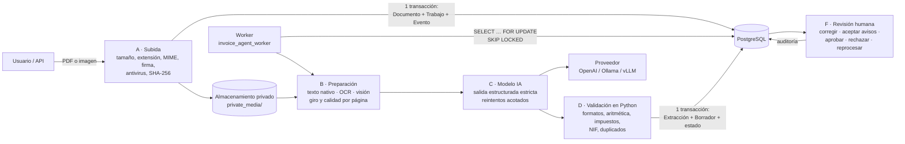

# Facturas con IA (`invoice_agent`)

Extracción de facturas de proveedores con un modelo de IA, validación determinista en Python y
**revisión y aprobación humana**. Aprobar una factura **no la contabiliza**: queda lista para que otro
paso (por ejemplo `cuadro_cuentas`) la registre más adelante.

- Pantallas: `/facturas-ia/` · API JSON: `/facturas-ia/api/…`
- Convive con `invoice_data` (Gestión de Facturas, OCR + reglas): reutiliza su OCR (Tesseract) y su
  catálogo de proveedores (`invoice_data.Proveedor`), y avisa si una factura ya está registrada allí.

## Arquitectura y flujo de datos



Máquina de estados del documento (`services/states.py`):

```
queued → processing → needs_review ⇄ pending_approval → approved (final)
             │  └→ failed                 └──────────────→ rejected
             └→ queued (reintento automático)
failed / needs_review / pending_approval / rejected → queued   (reprocesar, solo a petición)
```

- `needs_review`: hay errores o avisos de revisión sin resolver.
- `pending_approval`: todo cuadra o los avisos se aceptaron; falta que una persona apruebe.
- Solo una persona aprueba o rechaza. El worker nunca llega a `approved`.

## Decisiones de diseño

| Tema | Decisión |
|---|---|
| Framework | Django (el del proyecto), no FastAPI. API JSON con vistas de Django + Pydantic v2. |
| Cola | Tabla `Trabajo` en PostgreSQL creada **en la misma transacción** que el documento (bandeja de salida transaccional). El worker usa `FOR UPDATE SKIP LOCKED`, arrendamiento con caducidad y un bloqueo consultivo para el límite de concurrencia. Sin Redis ni Celery (Celery no es fiable en Windows). |
| Idempotencia | Mismo fichero en la misma empresa = mismo documento (`UNIQUE(empresa, sha256)`). Un solo trabajo activo por documento (índice único parcial). Un borrador por documento. Antes de guardar, el worker comprueba que el trabajo sigue siendo suyo: una entrega repetida no duplica nada. |
| Proveedor IA | Interfaz `ExtractionProvider` (`providers/base.py`). `OpenAICompatibleProvider` sirve para OpenAI y servidores locales cambiando `BASE_URL`. La lógica de negocio no depende del proveedor. |
| Salida del modelo | JSON Schema estricto generado desde Pydantic. Cada campo trae `status` (present/absent/unreadable), `value`, `confidence` y `evidence` (página y texto). El código añade `missing` cuando el valor no es utilizable. Nunca se inventa un valor. |
| Confianza | La que declara el modelo es una **señal**, no una probabilidad calibrada. Solo se usa para pedir revisión; los umbrales deben fijarse con la evaluación. |
| Validación | 100 % Python (`services/validation.py`). Tolerancias explícitas en unidades mínimas de la moneda. Reglas por jurisdicción separadas (`services/tax_rules.py`: IVA, IGIC, IPSI, recargo, IRPF; resto de países solo aritmética). |
| Dinero | `NUMERIC` en PostgreSQL y `Decimal` en Python; en la API los importes van como texto. |
| Auditoría | `EventoRevision` solo se añade. Cada corrección guarda valor extraído, anterior y nuevo. La extracción original (`Extraccion*`) es inmutable. |
| Inquilinos | `Empresa` (las entidades legales que reciben facturas). Toda consulta pasa por `scoped(queryset, ctx)`; el contexto se construye en el servidor. |
| JSONB | Solo para evidencias por campo, incidencias de validación, metadatos de preparación y la salida original del modelo (estructuras variables de auditoría). Los datos de negocio van en columnas. |

## Ficheros

| Fichero | Para qué |
|---|---|
| `models.py` | Empresa, Documento, Trabajo, Intento, Extraccion(+Linea, Impuesto), Borrador(+Linea, Impuesto), EventoRevision |
| `schemas.py` | Esquema de salida del modelo, esquema estricto, peticiones y respuestas de la API |
| `prompts.py` | Instrucciones versionadas (`PROMPT_VERSION`), delimitación del documento |
| `conf.py` | Configuración y valores por defecto |
| `providers/` | Interfaz, adaptador OpenAI-compatible, proveedor falso |
| `services/access.py` | Contexto de acceso (empresas permitidas, actor, permiso de aprobar) |
| `services/ingestion.py` | Etapa A: subida segura |
| `services/preparation.py` | Etapa B: texto nativo / OCR / visión, giro y calidad |
| `services/redaction.py` | Minimización: IBAN, tarjetas y correos fuera antes de llamar al modelo |
| `services/extraction.py` | Etapa C: llamada, reintentos, validación de la salida |
| `services/normalize.py` | Texto → Decimal / fecha / ISO; estados de campo |
| `services/validation.py`, `tax_rules.py` | Etapa D: validación determinista |
| `services/drafts.py` | Borrador, duplicados y revalidación |
| `services/worker.py` | Cola: reclamar, procesar, reintentar, fallidos |
| `services/review.py` | Etapa F: corregir, aceptar avisos, aprobar, rechazar, reprocesar |
| `services/states.py` | Máquina de estados |
| `services/storage.py` | Almacenamiento privado y URL firmadas |
| `api/` | API JSON |
| `views.py`, `forms.py`, `templates/` | Pantallas |
| `evaluation/` | Métricas, oráculo y juego de datos ficticio |
| `management/commands/` | `invoice_agent_worker`, `invoice_agent_evaluate`, `invoice_agent_retention` |

## Puesta en marcha (Windows, red local)

```powershell
pip install -r requirements.txt
copy .env.example .env        # y edita la clave / el modelo
python manage.py migrate      # crea las tablas y las empresas de INVOICE_OWN_NIF
python manage.py runserver 0.0.0.0:8000
# en otra terminal, el worker:
python manage.py invoice_agent_worker
```

- Sin worker, los documentos se quedan en «En cola».
- Para que arranque solo con el PC: una tarea del Programador de tareas de Windows que ejecute
  `venv\Scripts\python.exe manage.py invoice_agent_worker` al iniciar sesión.
- Varios workers (en el mismo PC o en otro de la red con acceso a la base de datos y a
  `private_media`) se reparten la cola; entre todos no pasan de `MAX_CONCURRENT_JOBS`.
- Las empresas se crean desde `INVOICE_OWN_NIF` / `INVOICE_OWN_NAMES`; se pueden editar en el admin.

### Servidor local en vez de OpenAI

```
INVOICE_AGENT_BASE_URL=http://IP-DEL-SERVIDOR:11434/v1
INVOICE_AGENT_MODEL=<modelo instalado en Ollama>
INVOICE_AGENT_SUPPORTS_VISION=False   # si el modelo es solo de texto
```

Requisitos orientativos: GPU NVIDIA con ≥ 12 GB de VRAM para un modelo de visión de 7–8B cuantizado;
con 8 GB, uno solo de texto. Con CPU funciona pero tarda minutos por factura.

### Activar usuarios y separación por empresa

1. `INVOICE_AGENT_REQUIRE_LOGIN=True` en `.env`.
2. En el admin: crear usuarios, añadirlos a `Empresa.usuarios` y dar el permiso
   «Can change borrador de factura» a quien pueda aprobar.
3. Configurar `LOGIN_URL` (por defecto `/accounts/login/`, que el proyecto aún no tiene) o entrar por `/admin/`.

## API

Todas las respuestas de error tienen la forma `{"error": {"code", "message", "details"}}`.
Las escrituras requieren la cabecera `X-CSRFToken` (protección CSRF de Django), como el resto del proyecto.

```bash
# Subir: multipart con «file» y «empresa» (202 = en cola; 200 = el mismo fichero ya existía)
POST /facturas-ia/api/documentos
{"id": "3f0c…", "estado": "queued", "estado_label": "En cola", "sha256": "…", "borrador_id": null, "duplicado": false, …}

# Estado
GET /facturas-ia/api/documentos/3f0c…
{"id": "3f0c…", "estado": "needs_review", "borrador_id": 7, …}

# Extracción, evidencias y validación
GET /facturas-ia/api/documentos/3f0c…/extraccion
{"modelo": "gpt-4.1-mini", "prompt_version": "factura-ia/1.0", "metodo": "native",
 "evidencias": {"gross_total": {"state": "present", "confidence": "high", "page": 1,
                                "text": "TOTAL 150,00", "extracted_value": "150.00"}, …},
 "validacion": [{"code": "TOTAL_MISMATCH", "severity": "error", "blocking": true,
                 "message": "Bases + impuestos = 121.00, pero el total de la factura es 150.00.", …}],
 "borrador": {"id": 7, "estado": "needs_review", "total_bruto": "150.00", "lineas": […], …}}

# Corregir (solo las claves enviadas) y aceptar avisos de revisión
PATCH /facturas-ia/api/borradores/7
{"total_bruto": "121.00", "aceptar_avisos": ["AMOUNT_DUE_MISMATCH"], "comentario": "Total mal leído"}
→ 200 {"estado": "pending_approval", …}

POST /facturas-ia/api/borradores/7/aprobar     {"comentario": "OK"}   → 200 {"estado": "approved", …}
POST /facturas-ia/api/borradores/7/rechazar    {"comentario": "No es nuestra"}
POST /facturas-ia/api/documentos/3f0c…/reprocesar {"descartar_correcciones": true}  → 202
GET  /facturas-ia/api/documentos/3f0c…/original → {"url": "…/original/<token>/", "expires_in": 300}
GET  /facturas-ia/api/borradores/7/eventos      → auditoría
GET  /facturas-ia/api/documentos?estado=needs_review&page=1&page_size=25
```

Códigos HTTP: 202 en cola · 400 petición mal formada · 401 sin sesión · 403 sin permiso para aprobar ·
404 no existe o es de otra empresa · 409 transición no permitida / duplicado aprobado / ya en cola ·
413 fichero grande · 415 tipo no admitido · 422 datos no válidos.

## Tests y evaluación

```powershell
python manage.py test invoice_agent
# Juego de facturas ficticias y evaluación (oráculo = prueba de la tubería, debe dar 100 %):
python manage.py invoice_agent_evaluate --build-demo eval_demo
python manage.py invoice_agent_evaluate eval_demo --oracle
python manage.py invoice_agent_evaluate eval_demo --output eval_demo\informe.json   # con el modelo configurado
```

Los tests no llaman a ningún proveedor real (proveedor y OCR falsos). Son `TestCase` de Django, así que
también funcionan con `pytest` + `pytest-django` si se instalan.

Para medir con facturas reales: carpeta **fuera del repositorio** con facturas anonimizadas y su
`<caso>.json` revisado a mano (formato en `evaluation/runner.py`). El informe da, por campo, exactitud,
precisión y exhaustividad; por documento, acierto de conciliación, tasa de revisión, número de líneas y
desglose de impuestos; precisión y exhaustividad de duplicados; latencia media y p95, tokens y coste.
Ningún resultado depende de un modelo actuando de juez. Úsalo para fijar umbrales y comparar
`PROMPT_VERSION` o modelos antes de cambiarlos.

## Operación

- **Fallidos**: filtro «Error» en la pantalla o `GET …/documentos?estado=failed`. El motivo está en
  `error_code` / `error_message` y en cada `Intento`. Se reprocesan con «Volver a extraer».
- **Logs**: una línea JSON por evento (`upload.accepted`, `job.claimed`, `job.succeeded`, `job.failed`,
  `provider.error`…), con `correlation_id` del documento; sin claves, textos de facturas ni importes.
- **Métricas**: cada `Intento` guarda duración, llamadas, tokens y coste estimado (admin → Intentos).
- **Retención**: `RETENTION_DAYS` fija una fecha de borrado; `python manage.py invoice_agent_retention`
  lista y `--apply` borra los originales caducados de documentos aprobados o rechazados (los datos y la
  auditoría se conservan). Revisa antes los plazos legales de conservación de facturas.
- **Copias de seguridad**: la base de datos **y** la carpeta `private_media/`.
- **Deshacer la migración**: `python manage.py migrate invoice_agent zero` borra las tablas de esta app
  (no toca las demás); los ficheros de `private_media/` se borran a mano.

## Limitaciones conocidas

- Que una factura cuadre **no** prueba que sea auténtica ni legalmente válida.
- La confianza del modelo no está calibrada; los avisos por confianza baja son orientativos.
- Las imágenes enviadas al modelo (visión) no se pueden redactar; se envían solo las páginas cuyo
  texto no basta y se puede desactivar con `ALLOW_VISION=False`.
- Sin login (configuración por defecto) cualquiera en la LAN puede ver y aprobar; la separación por
  empresa solo protege de verdad con `REQUIRE_LOGIN=True`.
- El enlace al original es un token firmado: quien tenga el enlace puede abrirlo hasta que caduque.
- El gancho antivirus (`MALWARE_SCANNER`) no trae escáner: hay que conectar uno (p. ej. ClamAV).
- Los tipos de IVA conocidos son una lista mantenida a mano; un tipo nuevo da solo un aviso.
- El OCR depende de Tesseract con el idioma español instalado.
- Los duplicados no se buscan entre empresas (a propósito: aislamiento).

## Lista de comprobación para producción

- [ ] `.env` con la clave real fuera de git; `SECRET_KEY`, `DEBUG=False` y `ALLOWED_HOSTS` del proyecto revisados.
- [ ] `REQUIRE_LOGIN=True`, usuarios por empresa y permiso de aprobar asignado.
- [ ] HTTPS si se accede fuera de la LAN.
- [ ] Worker arrancando solo y vigilado; alerta si hay documentos en `failed`.
- [ ] Escáner antivirus conectado en `MALWARE_SCANNER`.
- [ ] Copias de seguridad de la base de datos y de `private_media/`.
- [ ] Política de retención decidida y probada con `invoice_agent_retention` sin `--apply`.
- [ ] Evaluación con facturas reales anonimizadas; umbrales y modelo elegidos con datos.
- [ ] Precios por token configurados para medir el coste.
- [ ] Acuerdo de tratamiento de datos con el proveedor de IA (o servidor local).
